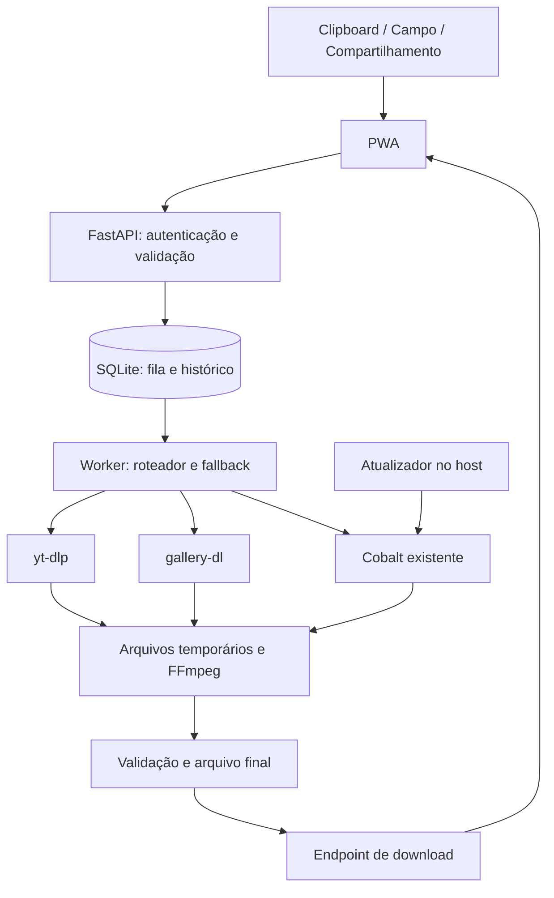

# DropLink — Downloader universal self-hosted

> Especificação de produto e implementação para Google Antigravity. Versão 1.0. Idioma da interface: português do Brasil. Nome provisório: DropLink.

## 0. Instruções para o agente de desenvolvimento

Implemente um aplicativo funcional, não apenas uma interface demonstrativa. Use esta especificação como fonte de verdade. Trabalhe por etapas, execute testes a cada etapa e mantenha um `README.md` atualizado com as instruções de instalação, operação e rollback.

O usuário já possui uma instância do Cobalt em uma VPS. Reutilize-a. Não remova containers, volumes, configurações, certificados, redes ou serviços existentes. Não assuma domínio, IP, distribuição Linux, portas, proxy reverso ou caminho do compose: use variáveis de ambiente e documente como identificá-los. Antes de alterar infraestrutura real, apresente o plano de mudanças e obtenha autorização. Não solicite credenciais em texto no código ou no chat.

Priorize simplicidade, estabilidade, privacidade, experiência mobile e baixo consumo de recursos. Evite dependências externas pagas e serviços de nuvem desnecessários. Não implemente acesso a mídias privadas, mecanismos de contorno de DRM ou de restrições de acesso. O produto é para baixar conteúdo próprio ou com autorização do titular.

## 1. Visão do produto

Criar uma alternativa pessoal ao Rposty/Cobalt, capaz de reconhecer links de várias plataformas e fazer o download automaticamente por meio do melhor motor disponível. Uma falha no Cobalt não deve derrubar o restante do sistema.

**Proposta:** Copiou. Abriu. Baixou.

- PWA instalável, com foco em Android/Chrome e suporte básico a desktop e iOS.
- Uma interface para Instagram, TikTok, YouTube, X/Twitter e outras plataformas suportadas.
- Detectar links no clipboard quando a página tiver foco e o navegador permitir; iniciar imediatamente o trabalho no servidor.
- Receber links diretamente do menu de compartilhamento do Android quando suportado.
- Manter sempre um campo de URL editável e botões de colar e baixar.
- Iniciar automaticamente a transferência ao dispositivo quando o arquivo estiver pronto e o navegador permitir.
- Reaproveitar a instância existente do Cobalt e acrescentar yt-dlp e gallery-dl, com fallback e atualização automática controlada.
- Sem anúncios, rastreadores ou cadastro público. Acesso pessoal autenticado.

## 2. Escopo e restrições reais

### 2.1 MVP obrigatório

Autenticação, clipboard, campo manual, compartilhamento PWA, download de vídeos, fotos e carrosséis públicos autorizados, roteamento por URL, fallback, progresso, histórico, painel de motores, Docker Compose, atualização do Cobalt com rollback, limpeza de temporários e testes automatizados.

### 2.2 Depois do MVP

Extração MP3, seleção avançada de resolução, notificações opcionais, APK Android nativo (por exemplo, Capacitor com plugin nativo adequado), múltiplos usuários, métricas avançadas. Não aumentar complexidade do MVP antecipadamente.

### 2.3 Limitações a respeitar

- Clipboard web precisa de HTTPS, foco e permissões; alguns navegadores exigem gesto explícito. Não prometa leitura silenciosa universal, monitoramento em segundo plano ou contorno dessas permissões.
- A PWA só recebe compartilhamentos pelo sistema se o navegador/plataforma e a instalação suportarem Web Share Target. Não prometer essa integração no iOS.
- O servidor pode concluir um job mesmo se a PWA for fechada. A entrega automática ao aparelho exige página ativa e pode requerer confirmação do navegador. Ao reabrir, recuperar o job e mostrar o botão de download; não declarar que o arquivo foi salvo na galeria apenas porque o servidor terminou.
- Plataformas podem mudar APIs, limitar IPs, impor login ou negar acesso. Tratar isso como erro explícito. Todos os motores podem falhar; não prometer 100% de sucesso.

## 3. Fluxos de usuário

### 3.1 Fluxo automático — principal

1. Usuário copia um link de Reel, vídeo ou publicação.
2. Abre o DropLink ou retorna ao aplicativo já aberto.
3. Após autenticação, o frontend tenta `navigator.clipboard.readText()` em contexto seguro e com a página focada, uma vez por abertura/retorno relevante.
4. Extrai apenas uma URL reconhecida de um texto compartilhado; nunca envia o texto inteiro do clipboard ao servidor. Se houver vários links válidos, solicita seleção em vez de escolher arbitrariamente.
5. Normaliza a URL, identifica a plataforma, preenche o campo editável e, se a opção automática estiver ativada, cria um job imediatamente.
6. Backend seleciona um motor, resolve e baixa a mídia; em falha técnica recuperável, tenta o próximo compatível.
7. Frontend apresenta status e progresso real, com opção de cancelar.
8. Quando o job fica pronto, inicia uma única tentativa de download do arquivo pelo navegador, pelo endpoint autenticado de entrega. Para carrosséis, um ZIP único evita múltiplos downloads automáticos.
9. Exibe confirmação de que o arquivo está pronto e disponibiliza **Baixar arquivo** novamente. Não afirmar que o arquivo chegou ao dispositivo sem confirmação confiável.
10. Salva o registro no histórico, inclusive motor usado, data, formato e resultado.

### 3.2 Clipboard e deduplicação

- Na primeira utilização, explicar o recurso e oferecer ativação explícita de download automático. Após essa configuração, operação sem cliques sempre que possível. Permitir desativar a qualquer momento.
- Capturar eventos `visibilitychange` para estado visível, `focus` e montagem inicial, com debounce (500 ms sugeridos) e mutex para impedir leituras concorrentes. Não usar polling contínuo. Não abrir diálogos repetidamente se a leitura falhar.
- Se `navigator.permissions` estiver disponível e suportar `clipboard-read`, consultar o estado; tratar browsers que não implementam a consulta. Ao negar ou exigir gesto, manter a interface utilizável e mostrar “Toque em Colar para importar um link”.
- Clipboard vazio, texto normal ou domínio desconhecido: não criar job, não transmitir dados, não interromper a interface.
- Não sobrescrever campo enquanto o usuário está editando. Ao clicar **Colar**, respeitar a ação explícita e substituir o valor; com modo automático ativo, pode iniciar imediatamente, com cancelamento disponível. O usuário pode desativar o automático para editar antes de baixar.
- Deduplicar a URL normalizada + opções do download durante jobs ativos e no fluxo automático recente (janela inicial de 10 minutos), inclusive após refresh. Usar armazenamento local apenas para identificadores/fingerprint e idempotência no servidor por usuário. Permitir repetição manual explícita.
- Nunca apagar o clipboard. Não tentar ler clipboard em background/service worker. Não registrar texto original em logs ou analytics.

### 3.3 Fluxo manual

Campo de texto sempre presente, editável, com limpar, botão **Colar URL** e botão **Baixar**. Aceitar colagem nativa no input se a API estiver bloqueada. Identificar plataforma instantaneamente ao editar, sem criar jobs a cada tecla. Enter inicia download quando válido. Exibir erros claros para URL inválida ou plataforma não suportada.

### 3.4 Compartilhamento Android

Adicionar manifest PWA com ícones, `start_url`, `scope`, `display: standalone`, e `share_target` com método POST, `application/x-www-form-urlencoded`, parâmetros `title`, `text` e `url`. Implementar endpoint same-origin/service worker receptor que trata URL frequentemente presente em `text` no Android, encaminha para a tela autenticada e recupera o compartilhamento após login. Evitar dados de URL sensíveis em query string/logs; usar token curto ou estado de sessão. Validar CSRF/origem nos endpoints de criação e não confiar no conteúdo recebido do compartilhamento. A criação do job acontece no frontend autenticado, após validar o link e a preferência de automação. Não criar job diretamente no POST do sistema operacional.

### 3.5 Histórico

Exibir downloads recentes, busca, filtro por plataforma, data, título (se disponível), resultado e motor. Ações: baixar novamente arquivo existente, repetir processamento, copiar URL, editar URL (preencher input sem autostart), remover registro. Se arquivo expirou, indicar e oferecer reprocessamento explícito. Não exigir que usuário visite histórico antes de baixar.

## 4. Interface

Mobile-first, responsiva, dark mode como padrão, visual simples estilo aplicativo utilitário. Tema claro opcional. Sem landing page de marketing. Ícones acessíveis, animações leves, contraste adequado e botões com área de toque de pelo menos 44 px.

```text
┌─────────────────────────────────┐
│ ⚡ DropLink            Histórico │
│                                 │
│     Copiou. Abriu. Baixou.       │
│                                 │
│ [ URL editável         ] [Colar]│
│ [          BAIXAR             ] │
│ ✓ Instagram detectado           │
│                                 │
│ Reel • MP4                      │
│ Baixando via yt-dlp…             │
│ ███████████░░░░░░               │
│ [ Cancelar ]                    │
│                                 │
│ Download automático       [ON]  │
│                                 │
│ Início  Histórico Motores Ajustes│
└─────────────────────────────────┘
```

Paleta sugerida: fundo `#101012`, superfícies `#1C1C20`, destaque `#A3E635`, texto claro e texto secundário cinza. O progresso não pode ser inventado: show spinner quando tamanho total for desconhecido, percentual aproximado somente quando identificado como estimativa. Exibir fases “Link detectado”, “Procurando mídia”, “Baixando”, “Preparando arquivo”, “Pronto para baixar” e “Falhou”. Informar troca de motor sem exigir intervenção. Mostrar duração e bytes apenas quando disponíveis.

A tela Motores apresenta versão instalada, saúde da API/processo, última tentativa bem-sucedida, último erro sanitizado, última atualização, próxima verificação e estado de manutenção. “Online” significa processo respondendo, não garantia de que todas as plataformas funcionam. Ajustes: download automático, qualidade padrão, modo de economia de dados, retenção, tema e motores habilitados.

## 5. Arquitetura e stack

- Frontend: React + TypeScript + Vite + Tailwind CSS + PWA/service worker.
- Backend: Python + FastAPI + Pydantic + HTTPX.
- Worker: Python, processo separado da API, com fila persistente em SQLite WAL para uso pessoal. Uma única VPS, sem Redis inicialmente. Transações atômicas e leases de jobs; não usar disco de rede para SQLite.
- Motores: yt-dlp, gallery-dl e HTTP adapter para Cobalt existente. FFmpeg/ffprobe dentro do worker; verificar requisitos de yt-dlp atuais (incluindo runtime JS quando aplicável).
- Deploy: Docker Compose; usar Nginx/Caddy/Traefik já existente para HTTPS, sem conflitar com portas.
- Arquivos: volume dedicado local; SQLite em volume persistente. Frontend servido na mesma origem da API. Sem necessidade de S3 ou banco externo.
- Atualizador: script no host + `systemd timer` (cron como alternativa), não dentro do frontend/backend.



## 6. Roteamento por domínio e tipo de mídia

Não use `startsWith("instagram.com")` ou busca por substring. Parseie URL com biblioteca padrão, valide scheme/hostname/portas e aceite apenas domínios exatos ou subdomínios explicitamente permitidos. Rejeite credenciais embutidas e domínios impostores. Aceite texto sem `https://` apenas se convertido localmente a partir de um domínio conhecido. Preserve parâmetros necessários (ex.: `v` do YouTube); remova somente tracking conhecido como `igsh`, `utm_*`, `fbclid`. Não alterar links assinados nem IDs. Para URLs curtas, resolver redirects de maneira controlada e validar cada salto.

Tabela inicial de preferência, configurável, sujeita a testes de compatibilidade na VPS:

| Plataforma / URL | Motor principal | Fallbacks em ordem |
| --- | --- | --- |
| Instagram `/reel/`, `/reels/` | yt-dlp | gallery-dl, Cobalt |
| Instagram `/p/`, `/tv/` | gallery-dl | Cobalt, yt-dlp (se vídeo) |
| Instagram Stories | gallery-dl (se acesso público suportado) | nenhum por padrão; experimental |
| YouTube / youtu.be | yt-dlp | Cobalt (se serviço habilitado) |
| TikTok / vm.tiktok.com | Cobalt | yt-dlp, gallery-dl (quando compatível) |
| X / Twitter | gallery-dl | Cobalt, yt-dlp (se vídeo) |
| Facebook / fb.watch | yt-dlp | Cobalt |
| Reddit / redd.it | yt-dlp | Cobalt, gallery-dl |
| Pinterest / pin.it | gallery-dl | Cobalt, yt-dlp (se vídeo) |
| Outros domínios | rejeitar | não usar extractor genérico indiscriminadamente |

Armazenar em `config/routes.yaml`, editar sem recompilar frontend. Incluir domínios curtos explicitamente. Verificar suporte real por plataforma, motor, formato e versão. Um erro de “não suportado” em um motor não significa que o conteúdo não seja suportado em todos. Para formatos específicos, evitar motor que não preserve o tipo solicitado. Não baixar perfis inteiros, playlists, canais ou páginas de feed no MVP.

## 7. Contrato dos motores e fallback

Todos os adaptadores implementam `supports(request)`, `health()`, `version()` e `download(request, workspace, progress_callback, cancellation_token) -> EngineResult`. Resultado normalizado inclui lista de arquivos locais, tipo MIME, bytes, título opcional, motor, versão, duração opcional e erro classificado. Não devolver URLs brutas de CDN ao frontend.

### 7.1 yt-dlp

Usar biblioteca Python ou subprocess com argumentos em lista, sem shell, timeout, sem playlists por padrão, diretório de saída por job e validação do arquivo pós-processado. Configurar qualidade e formato por enum validado. Sem cookies por padrão. FFmpeg para merge/remux quando necessário. Não confiar no título remoto como caminho de arquivo.

### 7.2 gallery-dl

Usar subprocess com configuração própria e destino por job; limitar quantidade de itens, tamanho e tempo; não extrair galeria/perfil ilimitado. Preservar ordem do carrossel com metadados, quando possível. Validar todos os arquivos antes de criar ZIP. Não considerar sucesso parcial como carrossel completo: indicar itens ausentes ou tentar fallback compatível, sem duplicar itens. Não aceitar configuração de comandos fornecida pelo cliente.

### 7.3 Cobalt

Consumir exclusivamente a instância própria configurada em `COBALT_API_URL`, com chave opcional em segredo no servidor (`Authorization: Api-Key ...`). Consultar documentação da versão em uso. Na API documentada atualmente, `GET /` retorna informações de versão e serviços, e `POST /` recebe JSON com URL, headers `Accept` e `Content-Type` apropriados. Usar, se suportado, `localProcessing: disabled` e opções de formato/qualidade homologadas.

- `tunnel`: consumir stream da própria instância, com limites de tempo/tamanho.
- `redirect`: obter mídia com validação de destino e redirects, nunca redirecionar diretamente usuário para URL não verificada.
- `picker`: processar itens válidos para foto/carrossel ou escolher vídeo de acordo com a solicitação; retornar arquivos normalizados.
- `error`: mapear código para erro recuperável ou terminal.
- `local-processing`: tratar como incompatível no MVP quando não for possível processar, habilitando fallback. Não assumir que todos os formatos de resposta são `url` simples.

A URL configurada em `API_URL` no Cobalt precisa funcionar para os túneis. Testar alcance a partir do worker, sem expor a API de maneira desprotegida. Não usar instâncias públicas do Cobalt sem autorização.

### 7.4 Política de falha

Tentar um motor por vez. Cada tentativa tem workspace isolado e limpeza de arquivos parciais. Falhas de conexão, erro de parser, formato incompatível ou timeout permitem fallback. Erros de autorização, CAPTCHA, mídia privada ou restrição explícita são terminais; não insistir para contornar acesso. Para rate limit, respeitar Retry-After, aplicar cooldown por plataforma e não trocar motor apenas para escapar do bloqueio. Se todos os motores falharem, retornar mensagem compreensível e permitir tentativa posterior.

Circuit breaker por motor para falhas de infraestrutura: exemplo, 3 erros consecutivos de conexão/5xx abrem circuito por 5 minutos; reavaliar com health check. Não classificar mídia removida como motor indisponível. Honrar cancelamento e limite total do job. Registrar motor efetivamente usado, não apenas o inicialmente selecionado.

## 8. API, fila e armazenamento

| Método e rota | Finalidade |
| --- | --- |
| `POST /api/jobs` | Criar job com URL, formato, qualidade e idempotency key |
| `GET /api/jobs/{id}` | Status, progresso, tentativa atual, arquivos disponíveis |
| `GET /api/jobs/{id}/events` | SSE de progresso; polling como fallback |
| `POST /api/jobs/{id}/cancel` | Cancelar job ativo |
| `GET /api/jobs/{id}/files/{file_id}` | Download autenticado e com Content-Disposition |
| `GET /api/history` | Histórico paginado |
| `DELETE /api/history/{id}` | Excluir histórico/arquivos do próprio usuário |
| `GET /api/engines` | Saúde, versões e última atualização |
| `GET /api/settings` / `PATCH /api/settings` | Preferências |
| `GET /healthz` / `GET /readyz` | Liveness/readiness minimalistas |

Todos os endpoints de dados exigem sessão; exceção apenas health checks internos e fluxo de login. Identificadores opacos UUID, autorização por job/arquivo, rate limiting e CSRF para operações de escrita. SSE com autenticação same-origin e reconexão. Não disponibilizar controles Docker diretamente pela API.

Estados: `queued`, `resolving`, `downloading`, `processing`, `ready`, `failed`, `cancelled`, `expired`. Persistir transições, horários, tentativa, mensagens sanitizadas, progresso em bytes ou nulo. Se o worker morrer, lease expirado recupera o job de modo idempotente; evitar repetir trabalho concluído. Após reiniciar, manter histórico e recuperar jobs ativos.

Tabelas sugeridas: `users`, `sessions`, `settings`, `jobs`, `job_attempts`, `files`, `engine_status`, `maintenance_events`. Índices em usuário/data/status. Migrações versionadas. Nunca guardar cookies das plataformas no DB ou URLs de mídia assinadas além do necessário.

## 9. Atualização automática e disponibilidade do Cobalt

Requisito principal: a instância existente deve receber correções publicadas no registro oficial do GitHub sem intervenção rotineira. O mecanismo recomendado é acompanhar imagens oficiais versionadas, não fazer `git pull` indiscriminado na branch de desenvolvimento.

### 9.1 Descobrir e integrar o Cobalt existente

1. Identificar nome, arquivo compose, projeto, tag de imagem, proxy e versão via `GET /` e comandos Docker no host.
2. Se já estiver em Compose, preservar arquivo, variáveis, mounts e `API_URL`. Se não estiver, documentar integração/migração antes de qualquer alteração.
3. Usar a imagem oficial `ghcr.io/imputnet/cobalt` com tag do major atualmente homologado (por exemplo, `:11` conforme exemplo oficial consultado; não migrar automaticamente de major sem testes). Uma tag de major recebe correções publicadas nessa linha; a tag `latest` também pode trazer mudanças incompatíveis.
4. Configurar `restart: unless-stopped` e health check HTTP para `GET /`, com timeout e intervalo. Health check sozinho não reinicia container unhealthy; utilizar monitor no host que só reinicie após falhas repetidas, cooldown e diagnóstico de recursos. O worker deve continuar apto a usar outros motores.

### 9.2 Atualizador do host

Criar `ops/update-cobalt.sh`, `ops/cobalt-update.service` e `ops/cobalt-update.timer`. Intervalo de verificação: 30 minutos, configurável. Usar `flock` para execução única; rodar com privilégio Docker apenas no host, nunca montar socket Docker no aplicativo. Integrar com os seguintes passos:

1. Registrar versão/digest atual e último estado saudável; não atualizar se a configuração estiver inconsistente.
2. Consultar/puxar a imagem do tag oficial já homologado, com `docker compose -f "$COBALT_COMPOSE_FILE" pull "$COBALT_SERVICE"`. Comparar ID/digest da imagem executada com a nova. Se forem iguais, encerrar sem restart.
3. Antes de recriar, preservar referência imutável da imagem antiga (tag local exclusiva ou digest) e backup protegido das configurações. Não executar prune. Manter pelo menos as duas últimas imagens saudáveis.
4. Sinalizar manutenção ao orquestrador, impedir novos jobs via Cobalt e aguardar os jobs Cobalt ativos por um prazo limitado; se não terminarem, adiar a atualização. Outros motores continuam disponíveis.
5. Recriar somente o serviço Cobalt (`docker compose ... up -d --no-deps --pull never "$COBALT_SERVICE"`), sem alterar outros containers ou volumes.
6. Esperar readiness com tentativas limitadas (ex.: até 90 segundos), validar `GET /`, contrato JSON e versão. Executar smoke test opcional apenas com URL pública autorizada configurada para esse fim. Não considerar uma falha de plataforma externa isolada como falha de boot.
7. Se falhar a compatibilidade ou readiness, restaurar imagem anterior via override de compose documentado, recriar só o Cobalt, revalidar e registrar rollback. Preservar digest rejeitado e cooldown para não repetir atualização quebrada em loop; voltar a tentar quando houver novo digest ou liberação manual.
8. Remover estado de manutenção após recuperação; se rollback falhar, deixar Cobalt indisponível, manter fallback e registrar alerta. Não declarar sucesso antes de verificar.

Publicar status sanitizado em arquivo JSON compartilhado read-only com backend, utilizando escrita atômica. Nunca expor segredos. Acompanhar também novas versões major do GitHub e sinalizar no painel; só promovê-las após validação deliberada. Documentar que novas correções só chegam quando a imagem oficial é publicada e que a verificação é periódica.

**Decisão de manutenção:** a documentação do Cobalt demonstra Watchtower, porém o repositório original `containrrr/watchtower` foi arquivado em 17/12/2025. Preferir timer do host com rollback. Se já existir Watchtower na VPS, inventariar e não deixar dois atualizadores concorrentes para o Cobalt; não desativar atualizações de outros serviços sem autorização.

### 9.3 yt-dlp e gallery-dl

Atualizar separadamente do Cobalt. Gerar imagem de worker com versões fixadas, dependências e changelog registrados. Verificar diariamente releases estáveis de yt-dlp e gallery-dl em fontes oficiais (gallery-dl também publica no Codeberg/PyPI). Construir nova imagem em staging, rodar testes de adaptadores e versão, drenar jobs do worker, promover somente após sucesso. Guardar imagem anterior e restaurar em caso de falha. Channel nightly do yt-dlp apenas opt-in. Não executar `pip install -U` dentro de container em produção a cada boot. No MVP, entregar rotina de verificação e atualização testada, com opção automática habilitável.

## 10. Segurança, privacidade e limites

- Acesso privado, sessão por cookie Secure/HttpOnly/SameSite, senha com Argon2id (ou autenticação por proxy existente corretamente configurada). Não criar senha padrão pública. Rate-limit de login e jobs. Não expor worker, banco, Cobalt ou Docker socket à internet sem necessidade.
- HTTPS obrigatório na interface. Mesma origem, CORS restrito, CSP e cabeçalhos de segurança. Service worker não deve cachear conteúdo privado, histórico, API ou arquivos de mídia. Não incluir segredos no bundle.
- Proteger contra SSRF: allowlist de hosts de origem; bloquear loopback, IPs privados/link-local/reservados, IPv6 equivalentes, IP literal e credenciais; validar redirects e DNS, impedir DNS rebinding no cliente HTTP/controle de egress; não permitir que executáveis externos ignorem esta política, usando isolamento de rede/filtragem de saída. Exceção de conexão interna apenas à origem Cobalt fixa e confiável pelo adaptador. Destinos CDN externos só quando validados segundo política específica. Nenhuma URL arbitrária deve alcançar rede interna ou metadados da VPS.
- Executar processos como usuário sem root, sem shell interpolado, com filesystem e permissões mínimos. Prevenir path traversal, symlink escape e ZIP inseguro. Sanitizar nomes, validar tipos por conteúdo, não servir HTML extraído com execução inline. Não expor logs brutos com tokens, URLs assinadas ou dados de clipboard.
- Limites iniciais configuráveis (não medidos na VPS real): 2 trabalhos concorrentes, fila máxima 20 por usuário, 500 MB por job, 50 itens por carrossel, 10 minutos totais por job, 24 horas de retenção do arquivo, 30 dias do histórico, 2 GB de espaço livre mínimo para aceitar novos jobs. Ajustar após testes. Aplicar limites em streaming, mesmo quando `Content-Length` estiver ausente. Limpeza periódica com lease para nunca apagar arquivo em uso. Cancelamento encerra subprocessos/streams e remove parciais.
- Não usar cookies de contas pessoais por padrão; não contornar autenticação, DRM ou restrições do serviço. Uso apenas para conteúdo permitido.

## 11. Estrutura de repositório sugerida

```text
Droplink/
  README.md
  .env.example
  .gitignore
  compose.yml
  config/routes.yaml
  frontend/
    src/{components,pages,hooks,services,styles}/
    public/{manifest.webmanifest,icons}/
    Dockerfile
  backend/
    app/{api,auth,models,services,worker,engines,security}/
    migrations/
    tests/
    requirements.lock
    Dockerfile
  ops/
    update-cobalt.sh
    cobalt-update.service
    cobalt-update.timer
    check-engine-updates.sh
    update-worker.sh
    backup.sh
  docs/{deployment,maintenance,troubleshooting}.md
```

Variáveis iniciais a documentar, com valores reais sempre fora do Git:

```dotenv
APP_URL=https://SEU-DOMINIO
COBALT_API_URL=http://cobalt:9000
COBALT_API_KEY=
COBALT_COMPOSE_FILE=/CAMINHO/REAL/compose.yml
COBALT_SERVICE=cobalt
COBALT_UPDATE_INTERVAL_MINUTES=30
MAX_CONCURRENT_JOBS=2
MAX_JOB_SIZE_MB=500
MAX_JOB_DURATION_SECONDS=600
FILE_RETENTION_HOURS=24
HISTORY_RETENTION_DAYS=30
```

`COBALT_API_URL` acima é exemplo, não pressupõe resolução DNS. Se os projetos Compose estiverem separados, usar rede Docker externa controlada ou endpoint existente protegido. Não copiar exemplos de segredos para produção. Configurar proxy para streaming/SSE sem buffering indevido e timeout adequado para downloads.

## 12. Plano de implementação e entregáveis

1. Inventário read-only da VPS/Cobalt e definição de variáveis de integração. Se ambiente não estiver acessível, disponibilizar comandos e placeholders; não alegar que testou a VPS.
2. Backend: autenticação, validação URL, SQLite, fila e contrato de motores. Primeiro yt-dlp (vídeo controlado) e gallery-dl (carrossel controlado), depois Cobalt real e fallback.
3. Frontend: tela principal, campo e colar, progresso, download automático, histórico, clipboard com permissões e deduplicação.
4. PWA: manifest/ícones/service worker, instalação e share target testado em Android real ou procedimento claro de verificação manual.
5. Docker Compose, volumes, proxy/HTTPS, autossegurança e limpeza. Documentar deploy paralelo ao Cobalt existente.
6. Atualizador do Cobalt + rollback + observabilidade. Implementar atualização do worker e testes.
7. Testes de aceitação, documentação de deploy/rollback, backup/restore SQLite e relatório de limitações conhecidas.

Entregar código executável, compose, `.env.example`, lockfiles, migrações, scripts de manutenção, testes, instruções de instalação e README. Não substituir integrações reais por mock em produção; mocks são permitidos apenas em testes/desenvolvimento.

## 13. Critérios de aceitação

- [ ] Com auto-download habilitado e clipboard permitido, abrir PWA com link autorizado de Reel cria exatamente um job sem toque adicional.
- [ ] Negar clipboard não cria job nem impede digitação/colagem manual; o usuário recebe orientação discreta.
- [ ] Retorno ao foco/refresh do mesmo link não duplica o download; editar link não é sobrescrito; repetir manualmente funciona.
- [ ] Share target Android recebe link mesmo quando vem no parâmetro `text`, mantém autenticação e deduplica.
- [ ] Vídeo, foto e carrossel permitidos são entregues com nomes úteis; carrossel vira ZIP único; progresso indeterminado não finge percentual.
- [ ] Navegador que bloquear entrega automática oferece botão manual; fechar e reabrir app recupera job concluído.
- [ ] Queda simulada do Cobalt provoca fallback técnico sem derrubar API ou perder histórico; erro de acesso privado não dispara tentativas de evasão.
- [ ] Domínios impostores, redirects para rede interna, path traversal e comandos injetados são rejeitados. Um usuário não pode acessar job de outro.
- [ ] Reiniciar containers preserva histórico e recupera jobs pendentes, sem trabalhos órfãos; cancelamento e limpeza funcionam.
- [ ] Atualizador não reinicia Cobalt se digest for igual, não toca em outros serviços, espera job ativo e registra versão/digest da imagem nova.
- [ ] Atualização quebrada simulada faz rollback, evita loop de nova instalação e permite que demais motores funcionem.
- [ ] README explica configuração real, HTTPS, acesso privado, manutenção, limites e diagnóstico de falhas.

## 14. Referências oficiais para implementação

Consulte as versões em uso no momento da implementação; não copie APIs de tutoriais antigos.

- Cobalt — execução da instância: https://github.com/imputnet/cobalt/blob/main/docs/run-an-instance.md
- Cobalt — API: https://github.com/imputnet/cobalt/blob/main/docs/api.md
- Cobalt — Compose de referência: https://github.com/imputnet/cobalt/blob/main/docs/examples/docker-compose.example.yml
- Cobalt — imagens oficiais: https://github.com/imputnet/cobalt/pkgs/container/cobalt
- Cobalt — repositório: https://github.com/imputnet/cobalt
- Watchtower original arquivado: https://github.com/containrrr/watchtower
- yt-dlp: https://github.com/yt-dlp/yt-dlp
- gallery-dl: https://github.com/mikf/gallery-dl e https://codeberg.org/mikf/gallery-dl
- Clipboard API: https://developer.mozilla.org/en-US/docs/Web/API/Clipboard_API
- Web Share Target: https://developer.chrome.com/docs/capabilities/web-apis/web-share-target
- Manifest share_target: https://developer.mozilla.org/en-US/docs/Web/Progressive_web_apps/Manifest/Reference/share_target
- Docker Compose: https://docs.docker.com/compose/

## 15. Instrução inicial para execução no Antigravity

Leia todo este documento e transforme-o em plano de implementação. Crie a estrutura real do projeto e mantenha um checklist de progresso. Comece pelos fundamentos e pelo fluxo completo de um Reel autorizado, com tratamento de erro, antes de ampliar plataformas. Use configurações existentes em modo read-only quando disponíveis; não altere a VPS sem autorização. Execute testes automatizados e informe, ao final de cada etapa, o que foi validado de fato, o que depende do ambiente e como reproduzir. O resultado final deve ser instalável em VPS via Docker Compose e utilizável como PWA, reaproveitando o Cobalt existente e implementando atualização automática controlada.
