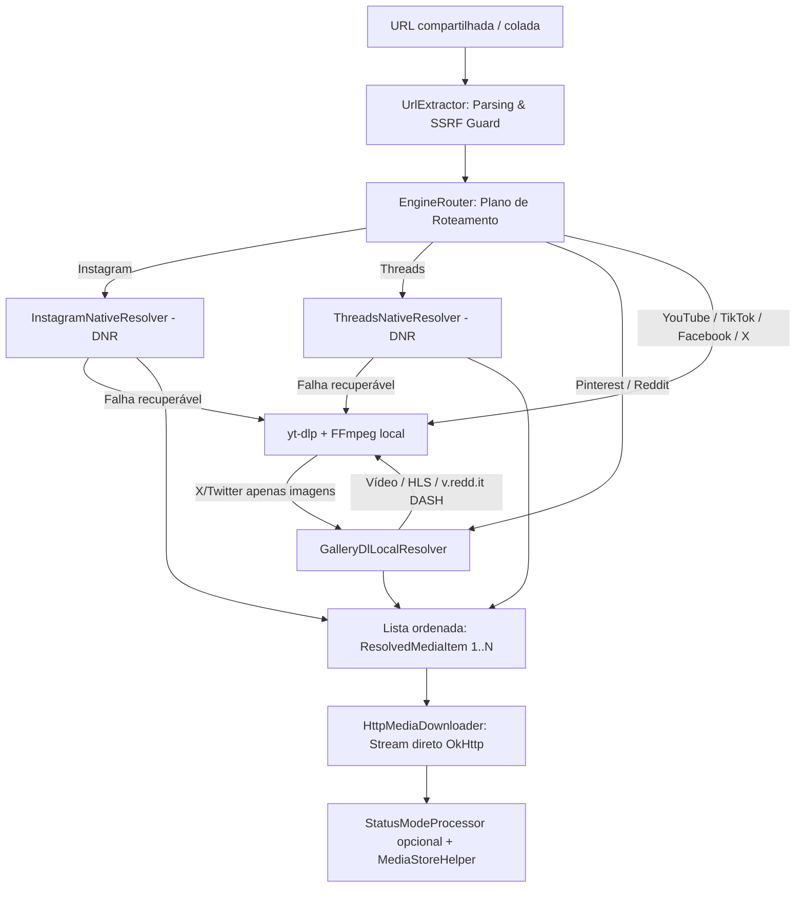

# Arquitetura do Devwolf Native Resolver (DNR) e Motores Locais

Documento técnico da camada de resolução nativa e roteamento local do **Devwolf Downloader** (`com.devwolf.downloader`), operando 100% no dispositivo Android sem dependência de servidor VPS.

---

## 1. Visão Geral e Separação de Responsabilidades

O fluxo de download local foi desacoplado em quatro etapas independentes, substituindo a execução acoplada e duplicada anterior:

### Módulos principais (`com.devwolf.downloader.resolvers`)
- **`ResolverContract.kt`**: Contrato unificado (`MediaResolver`, `ResolutionRequest`, `ResolutionResult`, `ResolvedMediaItem`, `ResolutionMetrics`, `DevwolfErrorCode` e `ErrorClassifier`).
- **`UrlExtractor.kt`**: Extração, remoção de parâmetros de rastreamento (`igsh`, `utm_*`, `fbclid`, `si`, etc.), parsing estrito de `/reel/`, `/reels/`, `/p/`, `/tv/`, `/stories/`, `/share/` e proteção SSRF (URL, literais IP, intervalos privados RFC1918, loopback, link-local `169.254.0.0/16`, CGNAT `100.64.0.0/10` e IPv6 ULA/mapeado).
- **`SafeHttpClient.kt`**: Pool compartilhado `OkHttpClient` com validação DNS antes da conexão, seguimento manual de redirecionamentos (máximo 5 saltos com checagem SSRF por salto), medição real de TTFB, contagem de requisições HTTP e escopo de headers sensíveis por domínio.
- **`InstagramParsers.kt`**: Parsers puros em Kotlin (`Jsoup` + `org.json`) para HTML/JSON público do Instagram e classificação precisa de falhas.
- **`InstagramNativeResolver.kt`**: Orquestrador de estratégias isoladas e cronometradas do DNR.
- **`ThreadsNativeResolver.kt`**: Resolvedor nativo independente para Meta Threads (`threads.com` / `threads.net`), suportando vídeos, fotos e carrosséis (`data-sjs`, `thread_items`, `ld+json`, OpenGraph e `/embed`) com sessão opcional no `SecureVault`.
- **`HttpMediaDownloader.kt`**: Downloader HTTP direto com progresso honesto em bytes, verificação de `Content-Type` e *magic bytes* (rejeitando HTML, playlists `.m3u8` e miniaturas disfarçadas de vídeo), cancelamento imediato e gravação atômica via arquivo `.part`.
- **`GalleryDlLocalResolver.kt`**: Resolvedor nativo local para Pinterest, Reddit e fallback de imagens do Twitter/X.
- **`EngineRouter.kt`**: Registro central de capacidades por plataforma, inicialização preguiçosa (*lazy*) do `yt-dlp`/Python e regras de fallback seguro.

---

## 2. Contrato de Erros Estruturados (`DevwolfErrorCode`)

Todos os motores (DNR, `yt-dlp` e `GalleryDlLocalResolver`) convergem para os 11 códigos abaixo, expostos diretamente à camada JavaScript/React:

| Código | Terminal? | Significado e Ação |
|---|---|---|
| `AUTH_REQUIRED` | Sim | Conteúdo exige sessão autenticada (`login_required` / `/accounts/login/`). Interrompe fallback. |
| `PRIVATE_MEDIA` | Sim | Conta ou publicação explicitamente privada (`"is_private": true` / conta privada). Interrompe fallback. |
| `RATE_LIMITED` | Sim | Limite de requisições atingido (`HTTP 429` / `"Please wait a few minutes"`). Interrompe fallback. |
| `CAPTCHA_REQUIRED` | Sim | Desafio anti-robô (`checkpoint_required` / `challenge_required` / CAPTCHA). Interrompe fallback. |
| `MEDIA_UNAVAILABLE` | Sim | Publicação removida, expirada ou inexistente (`HTTP 404` / `410`). Interrompe fallback. |
| `UNSUPPORTED_MEDIA` | Sim* | Link ou formato não suportado (*exceção controlada: Twitter/X sem vídeo aciona fallback local de imagens*). |
| `CANCELLED` | Sim | Cancelamento solicitado pelo usuário. |
| `STORAGE_ERROR` | Sim | Erro de permissão, espaço em disco ou gravação no `MediaStore`. |
| `EXTRACTOR_OUTDATED` | Não | Extrator desatualizado; permite atualização/fallback. |
| `EXTRACTION_FAILED` | Não | Falha genérica de parser ou mudança de layout HTML; aciona fallback técnico. |
| `NETWORK_ERROR` | Não | Erro de transporte, timeout ou HTTP `5xx`; permite tentativa/fallback. |

### Regra de Ouro contra Falsos Positivos
- Mudanças de layout HTML ou ausência de chaves JSON esperadas retornam **`EXTRACTION_FAILED`**, **nunca `PRIVATE_MEDIA`**.
- Avisos não fatais do `yt-dlp` (como `"WARNING: yt-dlp is more than 90 days old"`) são removidos pelo `ErrorClassifier.extractFatalErrorLines()` e jamais mascaram um erro de extração como conteúdo privado.

---

## 3. Estratégias Isoladas do Instagram (DNR)

Cada solicitação ao Instagram executa estratégias sequenciais e independentes, registrando tempo (`durationMs`), quantidade de requisições HTTP (`httpRequests`) e resultado por estratégia em `StrategyAttemptMetric` (exposto no diagnóstico sanitizado do `PerformanceTracker`):

- **Ordem adaptativa por sessão (`v3.0.0-rc.2`)**:
  - **Com sessão autenticada (`hasSession == true`)**: executa `WebPageJsonStrategy` -> `AuthorizedWebApiStrategy` -> `EmbedCaptionedStrategy`, enviando `Cookie` e `User-Agent` da sessão WebView capturada no `SecureVault`.
  - **Modo anônimo (`hasSession == false`)**: executa `EmbedCaptionedStrategy` -> `WebPageJsonStrategy` -> `AuthorizedWebApiStrategy`.
- **Classificação sem falsos positivos em `<script>`**: `InstagramParsers.classifyFailure` remove `<script>`, `<style>`, `<noscript>`, `<meta>` e `<link>` antes de inspecionar texto visível do DOM, só retornando `CAPTCHA_REQUIRED` em redirecionamentos `/challenge/` / `/checkpoint/`, payloads JSON estruturados de desafio ou widgets/formulários anti-robô visíveis no DOM. Falhas genéricas retornam `EXTRACTION_FAILED` para permitir o fallback para `yt-dlp` (que recebe o mesmo `User-Agent` da sessão do WebView via `--user-agent`).

1. **`EmbedCaptionedStrategy`**:
   - Consulta `https://www.instagram.com/p/{shortcode}/embed/captioned/?cr=1&v=14&wp=1080` com headers de navegador padrão.
   - Interpreta blocos `gql_data` / `shortcode_media`, `contextJSON` (inclusive serialização escapada) e fallback DOM (`EmbeddedMediaVideo`, `EmbeddedMediaImage`).
2. **`WebPageJsonStrategy`**:
   - Consulta a URL canônica (`/reel/{code}/`, `/p/{code}/`, `/tv/{code}/` ou `/stories/{user}/`).
   - Extrai contexto da página (`extractPageContext`), incluindo `media_id` em JSON embutido ou meta tags `<meta property="al:ios:url">` / `al:android:url`, além de `csrftoken`, `lsd` e `X-IG-App-ID`.
   - Interpreta blocos JSON modernos (`xdt_api__v1__media__shortcode__web_info`, `xig_polaris_media`, `xdt_api__v1__clips__clips_on_logged_out_connection_v2`, `fetch__XDTMediaDict`), legados (`window._sharedData`, `window.__additionalDataLoaded`), `application/ld+json` e tags OpenGraph.
   - Seleciona o candidato de maior resolução (`width * height`) em `video_versions`, `image_versions2.candidates` e `display_resources`.
   - Para links `/reel/`, impede que apenas uma capa `og:image` seja tratada como sucesso se não houver vídeo.
3. **`AuthorizedWebApiStrategy`**:
   - Executada apenas quando há sessão configurada no `SecureVault` ou tokens dinâmicos (`csrftoken`, `media_id`, `X-IG-App-ID`) extraídos da página anterior.
   - Consulta `api/v1/media/{media_id}/info/` (com `media_id` extraído do JSON ou de `al:ios:url`/`al:android:url`) ou `?__a=1&__d=dis` enviando `Cookie`, `User-Agent` da sessão e `X-CSRFToken` estritamente ao domínio `*.instagram.com`.

### Carrosséis Individuais (Sem `.zip`)
Posts com múltiplas mídias (`edge_sidecar_to_children` ou `carousel_media`) produzem uma `List<ResolvedMediaItem>` ordenada (`index = 1..N`), preservando tipo (`VIDEO` ou `IMAGE`), dimensões e nome de arquivo sequencial (`_01`, `_02`, ...). Cada item é baixado individualmente pelo `HttpMediaDownloader` e registrado no álbum apropriado do `MediaStore` (`Pictures/Devwolf Downloader` ou `Movies/Devwolf Downloader`).

---

## 4. Sessão Opcional via WebView e Cofre Criptografado

- **`InstagramSessionActivity.kt`**: Atividade opcional iniciada explicitamente pelo usuário nos Ajustes para acessar `https://www.instagram.com/accounts/login/` em um `WebView` padrão.
  - Não injeta keyloggers, não intercepta formulários e não lê senhas.
  - Lê `CookieManager.getInstance().getCookie("https://www.instagram.com")` apenas quando o host ativo é `*.instagram.com` e `sessionid` está presente.
  - Persiste cookie e `User-Agent` criptografados com AES-256-GCM via `EncryptedSharedPreferences` (`SecureVault.kt`).
- **Isolamento de Host**: `SafeHttpClient.scopeHeadersForHost()` e `HttpMediaDownloader` removem `Cookie`, `Authorization` e `X-CSRFToken` sempre que uma requisição ou redirecionamento aponta para CDNs externas (`cdninstagram.com`, `fbcdn.net`, etc.) ou domínios distintos.
- **Logout em Um Toque**: `InstagramSessionActivity.clearWebViewSession(context)` limpa `CookieManager.removeAllCookies`, `WebStorage.deleteAllData()` e revoga a entrada no `SecureVault`.
- **Sanitização de Logs**: `SafeHttpClient.sanitizeForDiagnostics()` mascara tokens, cookies e query strings assinadas antes de qualquer exibição ou cópia de diagnóstico.

---

## 5. Avaliação do `gallery-dl` Local no Android (`GalleryDlLocalResolver.kt`)

### Análise do Runtime Python Embutido (`youtubedl-android:0.18.1`)
A inspeção do artefato `io.github.junkfood02.youtubedl-android:library:0.18.1` mostra que o pacote já distribui `libpython.so` + `libpython.zip.so` (~14,3 MB por ABI) e `libqjs.so` (~916 KB por ABI) para executar o zipapp do `yt-dlp`.

Contudo, empacotar o `gallery-dl` Python como segundo zipapp dentro desse runtime apresenta desvantagens práticas no Android:
1. O `gallery-dl` exige dependências ausentes na stdlib enxuta empacotada para o `yt-dlp` (`requests`, `urllib3`, `charset_normalizer`, `idna`, `certifi`).
2. Cada extração via subprocesso Python sofre latência de inicialização (*cold start*) de ~1,5 s a 3 s no dispositivo móvel.
3. Aumentaria o tamanho do APK e exigiria um segundo ciclo de atualização de pacotes Python.

### Solução Adotada: Resolvedores Estruturados Nativos em Kotlin
O `GalleryDlLocalResolver.kt` implementa nativamente em Kotlin sobre o pool compartilhado `OkHttpClient`:
- **Pinterest (`pinterest.com`, `br.pinterest.com`, `pin.it`)**: Resolve redirecionamentos com proteção SSRF, lê `__PWS_DATA__`, `application/ld+json` (`VideoObject`) e OpenGraph para extrair imagens originais (`images.orig`), vídeos MP4 diretos (`V_1080P`/`V_720P` em `video_list`) e *Story/Idea Pins* multipágina em ordem `1..N`; quando um Pin de vídeo possui apenas stream HLS `.m3u8` ou capa sem `.mp4` direto, lança `EXTRACTION_FAILED` para delegar ao `yt-dlp` sem jamais retornar a capa como sucesso.
- **Reddit (`reddit.com`, `redd.it`, `oauth.reddit.com`)**: Resolve shortlinks e links de compartilhamento móvel `/r//s/<id>` (via redirect HTTP 3xx ou `<link rel="canonical">` / `og:url` no HTML, nunca anexando `.json` a `/s/<id>` não resolvido); quando há token OAuth2 (`SecureVault`), consulta `https://oauth.reddit.com/.../.json?raw_json=1` com `Authorization: Bearer` e `User-Agent` compatível; sem credenciais, bloqueios explícitos HTTP 401/403 retornam `AUTH_REQUIRED` específico do Reddit (sem alternância de hosts como `old.reddit.com`), enquanto respostas explícitas de comunidade/post privado preservam `PRIVATE_MEDIA`. Extrai galerias (`is_gallery` + `gallery_data.items` + `media_metadata`) na ordem exata, imagens diretas (`i.redd.it`) e GIFs silenciosos; para vídeos `v.redd.it` com áudio separado em DASH, delega automaticamente para o `yt-dlp` + `FFmpeg`.
- **Twitter/X Imagens (`x.com`, `twitter.com`)**: Fallback nativo via `cdn.syndication.twimg.com` quando o `yt-dlp` encontra um tweet contendo apenas fotos/carrossel de imagens.

Essa abordagem entrega **0 KB de aumento no APK**, resolução sub-segundo e 100% de autonomia local no dispositivo.

---

## 6. Tabela Central de Roteamento (`EngineRouter.kt`)

| Plataforma | Motor Primário | Fallback | Inicializa `yt-dlp`/Python antes? |
|---|---|---|---|
| **Instagram** (`/reel/`, `/p/`, `/tv/`, `/stories/`, `/share/`) | `DNR` | `yt-dlp` (apenas em erros recuperáveis) | Não (*lazy*) |
| **Threads** (`threads.com`, `threads.net`) | `DNR` (`ThreadsNativeResolver`) | `yt-dlp` (apenas em erros recuperáveis) | Não (*lazy*) |
| **Pinterest** (`pinterest.com`, `pin.it`) | `GalleryDlLocalResolver` | `yt-dlp` (Pins de vídeo) | Não (*lazy*) |
| **Reddit** (`reddit.com`, `redd.it`) | `GalleryDlLocalResolver` | `yt-dlp` (`v.redd.it` DASH) | Não (*lazy*) |
| **Twitter / X** (`x.com`, `twitter.com`) | `yt-dlp` | `GalleryDlLocalResolver` (tweets de imagem) | Sim |
| **YouTube / Shorts** | `yt-dlp` | — | Sim |
| **TikTok** | `yt-dlp` | — | Sim |
| **Facebook** | `yt-dlp` | — | Sim |
