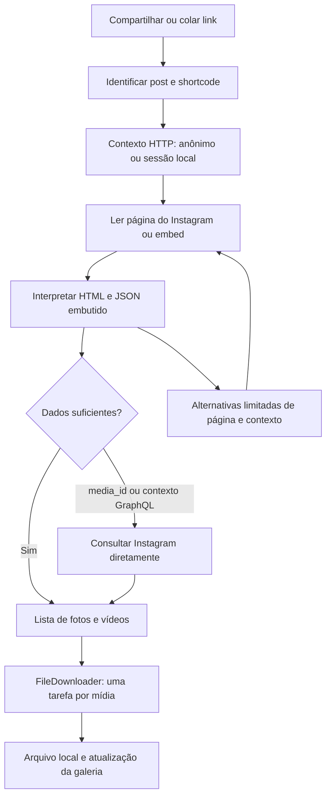

# Engenharia reversa do Rposty e comparação com Devwolf Downloader

Data: 17/11/2026. Escopo: entender o download do Instagram no APK fornecido e identificar o que é aproveitável na arquitetura do projeto. Nenhum código de produção foi alterado.

## Conclusão

O caminho de download rastreado no Rposty é um **resolvedor específico para Instagram executado no Android**, seguido de transferência HTTP das mídias. Ele lê HTML/dados embutidos do Instagram, reconhece diferentes formatos de resposta, faz consultas complementares de mídia/GraphQL quando necessário e converte o resultado em uma lista de fotos/vídeos. Cada item é baixado separadamente e registrado na galeria.

O fluxo observado não delega a resolução ao yt-dlp nem a um servidor próprio de extração. Isso é uma conclusão sobre a cadeia examinada, não uma prova de ausência de outros caminhos no aplicativo. Há servidores externos para outras funções; o domínio `vidtak.net` foi ligado a boletins, ajuda e políticas.

Para o Devwolf, o aprendizado principal é **separar resolução Instagram, lista de mídias, transferência e publicação na galeria**. Trocar apenas opções de yt-dlp não acrescentaria os parsers e o tratamento de carrossel encontrados no Rposty. Tampouco a análise prova que o Rposty tem maior taxa de sucesso hoje: não houve execução do APK ou teste de links reais.

## Identidade e limites do material

| Item | Observação |
|---|---|
| Arquivo | `docs/Rposty.apk`, 18.299.975 bytes |
| SHA-256 | `7c80ff4fac2637ea055d8943369b7649f6e93bc8c1a904d5c8015a19179daa80` |
| Package | `videodownloader.instagram.videosaver` |
| Versão declarada | `1.5.33R`, versionCode `10000235` |
| Android | minSdk 25, targetSdk 36 |
| Inventário REA/JADX | 11.212 classes; 2.171 recursos |
| DEX | `classes.dex` e `classes2.dex` |
| Splits | Manifest declara `requiredSplitTypes=base__abi` e metadados de splits; só foi fornecido este APK |

A identidade acima vem de E01. O nome do arquivo não comprova autoria ou procedência. A assinatura do APK não foi verificada. O inventário ZIP não contém `lib/`; isso não prova ausência de bibliotecas nativas nos splits não fornecidos. Não foi instalado aplicativo, acessada conta, coletado cookie real ou feito contato com endpoints extraídos do APK.

## Fluxo reconstruído

### 1. Entrada e seleção do post

`ShareActivity` recebe `ACTION_SEND`/`text/plain` e encaminha o texto para `StartupActivity` ou `MainActivity`. A etapa `X0.g.O` extrai o segundo segmento da URL como shortcode e chama `Q8.j.N`.

O rastreamento REA E06 confirma chamadas diretas para `Q8.j.N` a partir de `X0.g.O`, `ShowActivity.d0` e `Q8.j.S`: três métodos chamadores, cinco instruções de chamada identificadas. Isso corrobora a ligação entre interface e resolvedor, sem demonstrar execução em runtime.

Fontes exportadas: `ShareActivity.java:21`, `X0/g.java:337`; E04 e E06.

### 2. Obtenção de página e alternativas

`Q8.j.N` obtém cabeçalhos de sessão, seleciona URL original ou embed e passa a resposta para `A8.c`. O caminho sem sessão remove `cookie`, `User-Agent`, `x-csrftoken` e `processName` do mapa específico antes da requisição; o cliente HTTP pode ainda aplicar seus padrões.

`Q8.j.O` constrói `/embed/captioned/?cr=1&v=13&wp=1080`. `Q8.j.S` usa contador para alternar contexto, página original, embed e página inicial do Instagram. O contador começa em zero no fluxo de `X0.g.O`, é incrementado em `N` e impede novas tentativas quando excede três. Não é um fallback para outro serviço de download.

Não se deve copiar essa política cegamente: no Devwolf, erros terminais e limites de requisição devem encerrar o fluxo conforme as regras do projeto. O callback `Q8.g.d` também contém troca de User-Agent em determinada classe de erro; isso é observação, não recomendação de contornar limites.

Fontes: `Q8/j.java:106,164,241`, `Q8/g.java:44`; E04.

### 3. Parsers específicos de Instagram

O APK mantém modelos e parsers para diferentes gerações de payload:

| Forma reconhecida | Local principal |
|---|---|
| `xig_polaris_media` | `A8.c.E` |
| `xdt_api__v1__media__shortcode__web_info` | `A8.c.E` |
| `xdt_api__v1__clips__clips_on_logged_out_connection_v2` | `A8.c.E` |
| `fetch__XDTMediaDict` | `A8.c.E` |
| `xdt_api__v1__clips__home__connection_v2` | `A8.c.F` |
| `contextJSON` | `A8.c.D` |
| `window._sharedData` / `window.__additionalDataLoaded` | `A8.c.A/C` |
| HTML de embed para `GraphImage` | `G2.AbstractC0035e.f` |

O resultado intermediário é `V2_FitModel`. Ele pode transportar dados de mídia completos, `media_id`, modelo legado ou contexto necessário para outra consulta. Isso é mais abrangente que procurar uma única tag `og:video`.

**Limite importante:** JADX marca `A8.c.r`, o método agregador, como decompilado incorretamente, com falhas de reconstrução de blocos. A existência dos parsers e seus campos é sustentada pelo código recuperado; a ordem completa de todos os ramos e exceções desse agregador não foi validada por instruções DEX. E05 preserva a inspeção independente do parser `E`.

### 4. Consultas diretas e contexto anônimo

`Q8.j.M` escolhe como completar os dados:

- Quando existe `media_id`, chama a interface Retrofit para `api/v1/media/{mediaid}/info/` sobre a base `https://i.instagram.com/`.
- Quando existe `PublicCookieModel`, monta uma consulta GraphQL de post em `https://www.instagram.com/graphql/query`, com shortcode, `lsd`, nome da operação e um `doc_id` fixo no APK.
- Quando a mídia já está nos modelos V2/V4/legados, converte diretamente para `DownloadModel`.

O nome `PublicCookieModel` não significa um serviço externo fornecendo cookies. `M7.d.k` extrai da página campos como `lsd`, `csrf_token`, `device_id`, `machine_id` e `versioningID`. O modelo monta um cabeçalho a partir desses valores; não contém uma conta autenticada universal. `utils.j` prefere o contexto de sessão já disponível quando houver.

As strings de endpoints e IDs são evidência histórica desta versão do APK, não contratos oficiais estáveis nem garantia de funcionamento atual. O `doc_id` recuperado está preservado em E03, sem ser tratado como configuração recomendada para produção.

Fontes: `Q8/j.java:37`, `p148s8/b.java:55,72`, `M7/d.java:115`, `PublicCookieModel.java:54`, `utils/j.java:104`; E03.

### 5. Login e sessão

`LoginActivity` abre o Instagram em WebView/AgentWeb. Habilita JavaScript, DOM storage e cookies; registra a bridge `local_obj`. Quando está em home/explore e encontra `sessionid`, coleta o conteúdo de scripts da página para recuperar dados do perfil. Cookies e User-Agent são associados ao `LoginUserModel` e persistidos via LitePal.

Depois, `utils.j` reconstrói `cookie`, `x-csrftoken`, User-Agent e idioma para consultas. A presença textual de `sessionid` é a heurística local; não comprova sessão válida no servidor. Há variantes de login e diretórios WebView por processo, mas isso não prova anonimato ou isolamento de segurança completo.

Não foi identificada criptografia na cadeia de persistência examinada; não houve auditoria completa de armazenamento. Para o Devwolf, preservar o cofre já existente é uma escolha melhor que reproduzir esse armazenamento. Login de terceiros por padrão e acesso a mídia privada estão fora das regras atuais do projeto; este relatório não propõe habilitá-los.

Fontes: `LoginActivity.java:84,127,185,205`, `utils/conver/c.java:312`, `utils/j.java:42,141,149`, `com/bumptech/glide/d.java:173`.

### 6. Vídeos, fotos e carrosséis

`utils.conver.c.d/e` transforma os modelos em `DownloadModel` com uma lista de `DownloadObjectModel`. No formato V2, percorre `carousel_media`; nos modelos legados, percorre os itens equivalentes do sidecar. Cada item mantém tipo e URL.

Em `V2_ItemPostModel.getVideoUrl`, as versões são ordenadas por `getSize()` e a primeira é escolhida. Nesse modelo, `getSize()` significa **largura + altura**, não bytes nem bitrate. Portanto não há evidência para prometer seleção da maior qualidade perceptual ou do arquivo original.

`x8.i.c` cria uma tarefa FileDownloader usando `getLink()`; `x8.i.s/t` percorre os itens e inicia as tarefas. Ao concluir, o callback solicita `MediaScannerConnection.scanFile`. Não há ZIP no caminho de carrossel observado. Não se demonstrou transcodificação nesse caminho.

Fontes: `utils/conver/c.java:178,250`, `V2_ItemPostModel.java:414,671`, `V2_ItemPostSubModel.java:93,458`, `x8/i.java:117,420`, `o8/C3171d.java:42`, `k6/g.java:119`.

### 7. Servidores externos

A cadeia `utils.a` (exportada como `AbstractC3244a`) → `D8.b` → interface `s8.a` (exportada como `p148s8/a.java`) consulta `https://vidtak.net/insmate-lite/{language}/bulletin/bulletin.json`. O tipo retornado é `BulletinModel`. O mesmo domínio aparece em ajuda e políticas.

Isso não sustenta a hipótese de que o download principal seja resolvido por uma API própria do fornecedor. Também não permite afirmar que toda a comunicação do app foi auditada: há SDKs de publicidade/analytics, código obfuscado e possíveis comportamentos dinâmicos fora do escopo.

## Comparação com o projeto lido

Paths nesta seção são relativos à raiz do Devwolf Downloader.

| Área | Rposty observado | Devwolf atual |
|---|---|---|
| Resolução local | Parsers e consultas Instagram dedicados | `youtubedl-android`/yt-dlp genérico |
| Reels | Resolução específica e URL de mídia | Local primeiro; VPS como fallback técnico |
| Posts | Normalização em lista de mídias | VPS preferencial; local limitado a vídeo/áudio |
| Fotos | Itens individuais | Formato imagem exclui motor local |
| Carrosséis | Tarefa por item | `gallery-dl` pode entregar apenas ZIP |
| Sessão | WebView, cookies, UA, CSRF | Cookie manual no cofre; não enviado à VPS |
| Transferência | FileDownloader independente | Acoplada à execução yt-dlp no modo local |
| Galeria | Scanner de arquivos | MediaStore nativo |

O projeto usa yt-dlp, não apenas o antigo youtube-dl. `android/app/build.gradle:67` referencia `youtubedl-android` 0.18.1. `frontend/src/utils/url.ts:156` e `hybridOrchestrator.ts:130` definem a preferência local/VPS. `config/routes.yaml:57` define Reel → yt-dlp/gallery-dl/Cobalt e Post → gallery-dl/Cobalt/yt-dlp. Não foram executadas rotas remotas.

### Problemas identificados na leitura do Devwolf

1. **Contrato de erro Android/frontend incompatível.** `DevwolfDownloadService.kt:465` produz `TERMINAL_AUTH` e `TERMINAL_RATE_LIMIT`. `localQueue.ts:134,168` preserva os códigos, mas `hybridOrchestrator.ts:25` não os reconhece; as mensagens nativas também não casam com as regex atuais. `App.tsx:195` usa essa decisão para fallback. A função real foi transpilada e executada em memória: ambos retornaram `false`, enquanto DRM retornou `true`. Assim, com VPS disponível, esses erros podem gerar uma tentativa remota indevida. Evidência reproduzível em `scripts/verificar-erros.cjs` e `evidence/erro-terminal.json`.
2. **ZIP de carrossel encaminhado à galeria como mídia.** `gallerydl_adapter.py:326` devolve apenas ZIP para múltiplos itens. `useJobProgress.ts:123` pega o primeiro arquivo sem tratar `is_archive`; `DevwolfNativePlugin.kt:194` transfere sem extrair; `MediaStoreHelper.kt:48` usa coleção de vídeo para tudo que não é imagem/áudio. A cadeia não publica cada foto/vídeo do carrossel. A falha exata depende do Android e não foi reproduzida em aparelho.
3. **Extração duplicada de metadados.** `DevwolfDownloadService.kt:235` chama `getInfo(url)` antes de executar o request construído em `:432`. O cookie do cofre só é aplicado ao segundo request (`:457`). Isso pode aumentar latência e deixar metadados ausentes; não significa que o download necessariamente falhará, pois o erro de metadados é tolerado.
4. **Cobertura local incompleta para a prioridade Instagram.** `url.ts:174,222` exclui Stories e imagem do motor local. O fallback para yt-dlp em posts não implementa por si só a entrega de carrosséis mistos.

Esses pontos foram documentados, não corrigidos: o pedido desta etapa foi investigar o aplicativo de referência.

## Aplicação recomendada ao Devwolf

Esta é uma proposta derivada da comparação, não comportamento observado no APK nem implementação entregue.

1. Corrigir o contrato de erros e a entrega de carrosséis antes de adicionar outro motor. Usar payloads nativos reais em testes; não alternar motores para escapar de autenticação, CAPTCHA, conteúdo privado ou 429.
2. Introduzir um contrato interno de resolução: post → lista ordenada de itens com tipo, URL, dimensões, metadados, origem e contexto HTTP limitado ao destino. Separar resolução da transferência e da publicação no MediaStore. O contrato deve representar também falhas tipadas e URLs expiradas.
3. Manter yt-dlp para plataformas e fluxos onde funciona; acrescentar um resolvedor Instagram público e isolado como experimento mensurável. Validar uma estratégia por vez com posts autorizados e fixtures sanitizadas. IDs GraphQL e regex extraídos deste APK não devem ser promovidos automaticamente para produção.
4. Entregar carrosséis como itens individuais ao Android. ZIP pode continuar opcional na interface web. Não tratar arquivo genérico como vídeo.
5. Reaproveitar fila, cancelamento, notificações, MediaStore e Modo Status existentes. Transferir cookies somente ao host previsto, sem encaminhar indiscriminadamente para CDN, redirects ou VPS; evitar logs de cookies e URLs assinadas.
6. Medir sucesso, latência, quantidade de requisições e motivo de falha por estratégia. Testar Reel, vídeo em `/p/`, foto, carrossel misto, link compartilhado, mídia removida, 429, cancelamento e expiração de URL. Sessões reais só em uma etapa explicitamente compatível com o escopo do projeto.

## Cobertura e pendências

| Pergunta | Resultado |
|---|---|
| Projeto lido antes da análise do APK? | Sim: instruções, README, decisões e código do fluxo Instagram |
| Como obtém URLs? | Respondido estaticamente: página/parsers/API Instagram/GraphQL |
| Usa um backend próprio para a resolução rastreada? | Não encontrado nessa cadeia; consultas diretas identificadas |
| Como faz login e aproveita sessão? | Respondido estaticamente; sem login real |
| Como salva carrosséis? | Respondido estaticamente: item por tarefa, arquivo e scanner |
| Onde difere do Devwolf? | Comparação e problemas concretos documentados |
| Funciona hoje e melhor que yt-dlp? | Não determinado; exige teste controlado em runtime |
| Ordem exata do parser agregador `A8.c.r`? | Parcial: decompilação tem aviso de erro |
| Comportamento de splits/bibliotecas ausentes? | Não determinado com o único APK fornecido |

Foi realizada validação de identidade, integridade dos downloads das ferramentas, JSONs de evidência, referências de arquivos e reprodução do detector de erros. Não foi executado build/lint/teste completo de produto, pois nenhuma implementação foi modificada. Isso não certifica o estado global do projeto.

Consulte [METODOLOGIA.md](METODOLOGIA.md) para ferramentas/reprodução e [EVIDENCIAS.md](EVIDENCIAS.md) para proveniência dos achados.
